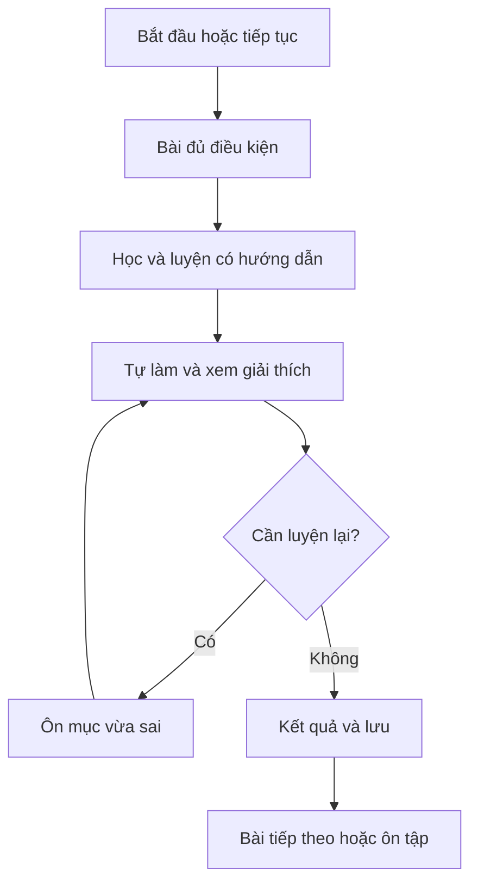

# Giai đoạn 2 — Thiết kế hành trình người mới HSK 1

Ngày: 2026-11-02 (Việt Nam). Trạng thái: **thiết kế đề xuất để nghiệm thu; chưa triển khai**.

## 1. Phạm vi và bằng chứng

- Nhánh `refactor/learning-safety-a5bb852`; baseline `e53130eeb59344e78f63ac9499cc9086a3d0214d`; [PR #1](https://github.com/dungvt1234/aster-hsk-master/pull/1) open/draft, chưa merge. Checkout sạch, remote head trùng baseline lúc bắt đầu.
- Đầu vào: [kế hoạch](../ke-hoach-hoan-thien-lo-trinh-hsk.md), [kiểm kê GĐ1](hsk1-phase1-inventory.md): 9 unit, 40 chặng, 71 câu; kho V/G/U và nguồn S1–S3 được định nghĩa ở báo cáo đó.
- Đọc thêm `src/services/studySession.ts` (`loadCompletedNodes`, `roadmapNodeStatus`, `recordCompletedNodes`), `src/services/learningBackup.ts`, `src/services/storageTransaction.ts`, `src/components/DuolingoPathView.tsx` và `src/App.tsx`.
- Chỉ thêm tài liệu. Không thay nội dung học, ID, dữ liệu người học, cách mở khóa hoặc điều hướng; không thêm dịch vụ/tài khoản/AI; không merge/deploy. Không triển khai GĐ3 trong lần bàn giao này.
- Các ngưỡng luyện tập, trình tự và ID mới dưới đây là quyết định thiết kế đề xuất, không phải chuẩn thi được xác nhận. Chưa chọn phiên bản HSK/ISBN; tên sản phẩm HSK 1 không đồng nghĩa đã bao phủ một danh mục kỳ thi chính thức.

## 2. Kết quả người học nhìn thấy

Màn hình học có ba điểm vào: **Tiếp tục học**, **Ôn câu đã sai**, **Xem lộ trình**. Khi chưa học, nút chính ghi “Bắt đầu: Chữ Hán và cách đọc”. Khi đang học, hiện tên bài tiếp theo, mục tiêu một câu và phần cần ôn; không hiển thị dữ liệu hoạt động mô phỏng như hoạt động thật.

Bài tiếp theo là bài đầu chưa hoàn thành và đủ điều kiện trong đường học được chọn. Nếu có nhiều bài được mở do tiến độ cũ, gợi ý bài sớm nhất còn thiếu nhưng vẫn cho mở lại bài đã có quyền truy cập. Nếu hết bài lõi, gợi ý ôn lỗi hoặc bài ôn tổng hợp; không tự chuyển sang HSK 2 hay tuyên bố đủ điều kiện thi.

“Ôn câu đã sai” dùng sổ lỗi hiện có. Khi không có lỗi thì ghi “Chưa có câu cần ôn”, cho chọn ôn tự nguyện; không bịa số lỗi. Ôn từ theo lịch là chức năng riêng đã có; chưa gán mọi lỗi câu ghép vào thuật toán ôn thẻ từ. Không cần hệ thống lịch/nhắc nhở mới.

Sơ đồ mô tả trải nghiệm dự kiến. Không có vòng lặp ép học vô hạn: sau một lượt luyện lại, người học có thể kết thúc với trạng thái “cần ôn thêm”; không ép lặp đến khi đúng mới cho thoát. Trạng thái hoàn thành bài và kết quả tự làm phải được phân biệt (§4).

## 3. Trình tự và kiến thức trước bài

Giữ unit ID cũ để tra cứu/khôi phục; dùng nhóm hiển thị thay vì đổi số unit làm khóa lưu trữ. Nhãn nhóm hiển thị không được dùng như ID tiến độ. Mỗi hàng là một cụm bài; thứ tự chính xác từng bài trong bảng §5.

| Thứ tự | Cụm | Điều kiện đầu vào | Kết quả cần luyện | Nguồn/tái sử dụng | Ràng buộc |
|---|---|---|---|---|---|
| 1 | Làm quen chữ Hán, pinyin và thanh điệu | Không | Phân biệt chữ/cách đọc/nghĩa; biết dấu thanh; nghe phân biệt một số âm đã giới thiệu | G01, PinyinMasterStudio; S1/S2/S3 ở mức văn bản | Chỉ mẫu nhỏ phục vụ bài đầu; không ép học hết bảng âm trước giao tiếp |
| 2 | Chào → cảm ơn/tạm biệt → xin lỗi → tên/quốc tịch → sức khỏe | Ba bài nền tảng | Dùng đúng cặp xã giao, hỏi tên, 是/吗, trả lời sức khỏe | Unit 1, G01–03/G08, S1–S3 | C04 dạy đủ 谢谢/再见/不客气 trước các câu cũ, C05 luyện sâu; dạy 也/很 trước lời đáp; không coi G01 đã tự động được học |
| 3 | Số 1–5 → 6–10 → hàng chục | Cụm xã giao; nền tảng nghe | Nhận diện, nghe và ghép số trong phạm vi đã dạy | Unit 0, V số đếm, U0 | Chưa dạy giá tiền ở cụm này; 一百 chưa thành mục tiêu khi chưa có bài |
| 4 | Gia đình và sở hữu | Số đếm; 这/那/是 | Người thân, 有/几口人, 的 | Unit 2, G03/04, U2 | Dạy từ của bài cúp trước khi yêu cầu ôn; không dùng 个 làm nhiễu khi câu hỏi chưa rõ |
| 5 | Ăn uống và sở thích | 吗; câu chủ–vị cơ bản | Đồ ăn/uống, 想/喜欢, 太…了 | Unit 3, G06/10/12 | “Khen món ăn” là nhãn sát bài hiện có; giao dịch gọi món chưa có thì không hứa |
| 6 | Ngày tháng, giờ và lịch trình | Số ghép; 去/不/是 | 几月几号/几点; buổi; câu thời gian | Unit 4, G05/07/09, U4 | Dạy 点/分/了 trước nghe giờ; giới thiệu 学校 trước câu lịch trình |
| 7 | Mua sắm thiết yếu | Số ghép; 想; tiền/đơn vị được dạy tại bài | Hỏi giá, đơn giá, lượng từ đồ uống, tổng tiền | Unit 5, G04/06/10/12 | Duyệt biến thể thứ tự hỏi giá; tiền mặt/mặc cả thành mở rộng, chưa dạy quét ví |
| 8 | Trường học | 是/吗/有/去; thời gian | 都, 会 khả năng, sách/bàn ghế, 在/上, liên động | Unit 6, G04/05/08/14 | “Nhận diện chữ” khác với “đã biết viết”; chưa kiểm tra viết bằng câu ghép |
| 9 | Địa điểm và đi lại | 在/有/去; cấu trúc vị trí được giới thiệu | 在哪儿, 前面/旁边, 怎么去/坐 | Unit 7, G08/09/11 | Trái/phải/gần và 就 được dạy ngắn trước bài; chưa gọi là đầy đủ phương vị |
| 10 | Thời tiết và sở thích | 喜欢, 太…了, thời gian | 天气怎么样; giải trí, dự báo mẫu đơn giản, lời rủ | Unit 8, G05/07/10/12 | 会 dự báo tách nghĩa với 会 kỹ năng; 春/夏 không đủ để đặt tên “bốn mùa” |
| 11 | Ôn tổng hợp đã học | Hoàn thành các bài lõi; với người cũ cho mở để tự đánh giá | Nhớ và vận dụng một số mục tiêu từ các cụm | Câu biên soạn/duyệt mới theo dữ liệu đã học | Không dùng lời chúc tốt nghiệp làm bài kiểm tra; không chấm như điểm chứng chỉ |

Phát âm được nhắc lại từng đoạn ngắn: 3+3 trong chào hỏi; thanh nhẹ trong 谢谢/妈妈; biến điệu 不 trước 不是/不客气; 一 trước cụm lượng từ; vị trí dấu thanh và cách viết ü khi gặp từ thực tế. Mỗi đoạn phải tách cách ghi thanh gốc và cách đọc. Kho Pinyin hiện có là tài liệu hỗ trợ, không tự nhận có bài nghe đã đối chiếu chỉ vì có nút TTS.

Các cụm 4–10 chưa được ba bài nguồn Drive xác minh về toàn bộ nội dung. Trước khi biên tập hàng loạt phải ghi nguồn/chương trình cho từng bài. GĐ2 sắp xếp chủ đề theo phụ thuộc nội bộ, không kết luận phù hợp tuyệt đối một chuẩn HSK.

## 4. Hợp đồng một bài học

| Bước | Nội dung bắt buộc | Điều kiện chuyển tiếp |
|---|---|---|
| Mục tiêu | Một mục tiêu quan sát được; kiến thức cần biết; nút mở phần giải thích khi chưa nhớ | Người học biết sẽ làm gì; không tự lưu hoàn thành |
| Kiến thức mới | Hán tự + pinyin + nghĩa + cách dùng; mỗi từ/điểm mới có vị trí được dạy | Không hỏi từ/ngữ pháp mới mà chỉ để giải thích sau khi sai |
| Ví dụ | Mẫu đúng ngữ cảnh; chỉ rõ âm và nghĩa; TTS ghi “giọng thiết bị” | Có thể nghe lại; nếu không có giọng thì báo không khả dụng |
| Luyện có hướng dẫn | Có gợi ý; có thể nghe nguyên mẫu và xem cách làm | Không tính như kết quả tự trả lời |
| Tự làm | Ẩn đáp án; câu nghe không hiện chữ/pinyin/accessible name chứa đáp án; câu dịch không có nút đọc toàn câu đích | Chưa chọn không chấm; yêu cầu và khóa đáp án nhất quán |
| Ôn và giải thích | Giải thích vì sao đúng/sai; luyện lại đúng điểm sai; quyền thoát sau một lượt ôn | Không ép vòng lặp, không đánh đồng lần trả lời sau gợi ý với lần đầu |
| Kết quả và lưu | Số đúng lần đầu/tổng câu tự làm; kết quả ôn riêng; trạng thái lưu, nút tiếp tục | Chỉ báo “đã lưu” sau ghi thành công; lỗi giữ kết quả để thử lại |

Khung biên tập ban đầu: khoảng 3–5 mục từ/cụm mới, 1–2 điểm dùng; 2 câu có hướng dẫn và 4 câu tự làm cho một bài nhỏ. Đây là ngân sách thử nghiệm, có thể điều chỉnh khi thử bài mẫu, không phải quy định tất cả bài phải có đúng số đó. Không mở rộng nội dung để đạt số câu một cách máy móc.

**Hoàn thành và mức nhớ:** hoàn thành nghĩa là đã đi hết bài và xem phần ôn; ví dụ 2/4 lần đầu vẫn lưu “đã học — cần ôn thêm”. Không ghi “thành thạo”. Đề xuất nhãn “đã tự làm tốt” khi đúng ít nhất 3/4 ở bài mẫu; nhãn này không khóa bài tiếp theo và chưa là chuẩn HSK. Khi mở lại bài, số liệu lịch sử không bị đổi bởi việc chỉ xem. Quy tắc mới phải chỉ áp dụng ở bài mẫu độc lập GĐ3 trước, chưa thay cách tính XP/hoàn thành của 40 node hiện tại.

**Chấm bài:** câu chọn phải có một đáp án rõ trong ngữ cảnh; c-1-2-2-1 cần nêu mẫu có 口, không phủ định mọi cách dùng 个. Câu ghép có danh sách các chuỗi được duyệt cho đúng token, không nhận mọi hoán vị. Ví dụ c-1-5-1-2 cần duyệt cả 苹果一斤多少钱 và 苹果多少钱一斤. Câu dịch “rất lạnh” phải khớp nghĩa tự nhiên của câu đích, không tự thay bằng “lạnh quá”. Giữ ID câu cũ khi sửa cùng mục tiêu; nếu đổi mục tiêu, tạo câu mới và giữ câu cũ trong phiên bản cũ cho tới khi kế hoạch nội dung được duyệt.

**Audio:** âm thanh chỉ dùng nếu đúng câu và rõ quyền; trước mắt có thể dùng giọng thiết bị với nhãn thật. Không ghép track MP3 theo số thứ tự. Khi audio không hoạt động, bài tự làm nghe có lựa chọn thử lại hoặc rời bài; không chuyển sang hiện chữ rồi ghi nhận như đã làm đúng bài nghe.

## 5. Bảng ánh xạ toàn bộ bài cũ → đường học đề xuất

Quy tắc chung cho cả 40 dòng: **tái dùng nguyên ID**, giữ trạng thái đã hoàn thành. “Bổ sung” nghĩa là đề xuất biên tập ở giai đoạn sau, không làm mới trạng thái bài cũ. Bài mới dùng ID riêng trong §6. Tất cả 9 cúp giữ quyền truy cập và lịch sử, đề xuất chuyển sang ôn tùy chọn trong GĐ4; không đánh dấu cúp hoàn thành chỉ vì được chuyển vị trí.

Vị trí `Cxx` là thứ tự bài lõi đề xuất, không phải ID lưu. `Oxx` là bài ôn tùy chọn, gắn cạnh cụm tương ứng. Người mới không cần hoàn thành Oxx để mở bài lõi tiếp theo. Việc bỏ cúp khỏi điều kiện mở khóa chỉ được bật sau kiểm thử migration.

| ID cũ | Tên hiện tại | Vị trí mới | Hành động nội dung / phụ thuộc cần bổ sung | Tác động tiến độ/mở khóa đề xuất |
|---|---|---|---|---|
| `node-hsk1-0-1` | Số đếm 1 đến 5 | C09 | Giữ số 1–5; tái dùng phần nhập môn riêng, không để thay thế cả học phát âm | Giữ hoàn thành/quyền cũ; khi chưa học dùng điều kiện lõi mới |
| `node-hsk1-0-2` | Số đếm 6 đến 10 | C10 | Dạy cách đọc 6–10 trước luyện | Giữ hoàn thành/quyền cũ; khi chưa học dùng điều kiện lõi mới |
| `node-hsk1-0-3` | Ghép số hàng chục | C11 | Dạy ghép hàng chục; thu hẹp nhãn theo câu thực tế, chưa hứa số 100 | Giữ hoàn thành/quyền cũ; khi chưa học dùng điều kiện lõi mới |
| `node-hsk1-0-4` | Cúp Vinh Quang Số Đếm | O01 | Ôn nhận diện số đã học; không là kiểm tra toàn bộ số | Giữ hoàn thành/quyền cũ; ôn tùy chọn, không chặn lõi |
| `node-hsk1-1-1` | Chào hỏi cơ bản | C04 | Chào một người/lịch sự; dạy cả 谢谢/再见/不客气 trước câu cũ; C05 luyện sâu cặp cảm ơn | Giữ hoàn thành/quyền cũ; khi chưa học dùng điều kiện lõi mới |
| `node-hsk1-1-2` | Hỏi tên & Giới thiệu | C07 | Dạy 叫/什么/名字/是/吗 và quốc tịch trước tự làm | Giữ hoàn thành/quyền cũ; khi chưa học dùng điều kiện lõi mới |
| `node-hsk1-1-3` | Hỏi thăm sức khỏe | C08 | Dạy 也/很 và cả lời hỏi trước lời đáp; sửa nhãn nếu chỉ giữ bài đáp | Giữ hoàn thành/quyền cũ; khi chưa học dùng điều kiện lõi mới |
| `node-hsk1-1-4` | Cúp Vinh Quang Chào Hỏi | O02 | Ôn xã giao; bài xin lỗi mới phải dạy từ trước; giữ lịch sử cúp | Giữ hoàn thành/quyền cũ; ôn tùy chọn, không chặn lõi |
| `node-hsk1-2-1` | Thành viên gia đình | C12 | Dạy đại từ chỉ định và tên người thân trước ghép | Giữ hoàn thành/quyền cũ; khi chưa học dùng điều kiện lõi mới |
| `node-hsk1-2-2` | Hỏi số lượng nhân khẩu | C13 | Dạy 有/几/口, làm rõ câu hỏi tránh nhiễu 个 không có ngữ cảnh | Giữ hoàn thành/quyền cũ; khi chưa học dùng điều kiện lõi mới |
| `node-hsk1-2-3` | Trợ từ sở hữu 的 | C14 | Dạy 的 và phân biệt 这/那 | Giữ hoàn thành/quyền cũ; khi chưa học dùng điều kiện lõi mới |
| `node-hsk1-2-4` | Cúp vinh quang Gia đình | O03 | Dạy 弟弟/妹妹/儿子/女儿 ở phần học của cụm gia đình trước khi ôn | Giữ hoàn thành/quyền cũ; ôn tùy chọn, không chặn lõi |
| `node-hsk1-3-1` | Món ăn & Đồ uống | C15 | Dạy tên đồ ăn/uống và 想 | Giữ hoàn thành/quyền cũ; khi chưa học dùng điều kiện lõi mới |
| `node-hsk1-3-2` | Sở thích ẩm thực | C16 | Dạy 喜欢 + động từ, nối lại 吗 | Giữ hoàn thành/quyền cũ; khi chưa học dùng điều kiện lõi mới |
| `node-hsk1-3-3` | Gọi món tại nhà hàng | C17 | Đổi nhãn đề xuất sang khen món ăn; dạy 太…了 trước câu hỏi | Giữ hoàn thành/quyền cũ; khi chưa học dùng điều kiện lõi mới |
| `node-hsk1-3-4` | Cúp Vinh Quang Ẩm Thực | O04 | Ôn động từ ăn/uống; không coi là thi gọi món | Giữ hoàn thành/quyền cũ; ôn tùy chọn, không chặn lõi |
| `node-hsk1-4-1` | Hôm nay ngày mấy? | C18 | Dạy ngày/tháng/thứ, chỉ hỏi phạm vi đã giới thiệu | Giữ hoàn thành/quyền cũ; khi chưa học dùng điều kiện lõi mới |
| `node-hsk1-4-2` | Hỏi giờ giấc chính xác | C19 | Dạy 点/分/现在/了 trước nghe giờ | Giữ hoàn thành/quyền cũ; khi chưa học dùng điều kiện lõi mới |
| `node-hsk1-4-3` | Lịch trình trong ngày | C20 | Dạy buổi; thêm câu lịch trình nếu giữ mục tiêu lịch trình | Giữ hoàn thành/quyền cũ; khi chưa học dùng điều kiện lõi mới |
| `node-hsk1-4-4` | Cúp Vinh Quang Thời Gian | O05 | Ôn lịch trình; giới thiệu 学校 ở bài học trước khi ôn | Giữ hoàn thành/quyền cũ; ôn tùy chọn, không chặn lõi |
| `node-hsk1-5-1` | Hoa quả tươi ngon | C21 | Dạy 斤; duyệt biến thể thứ tự hỏi giá | Giữ hoàn thành/quyền cũ; khi chưa học dùng điều kiện lõi mới |
| `node-hsk1-5-2` | Đơn vị tiền tệ & Mua bán | C22 | Dạy 块/元; bỏ gợi ý đáp án bằng nhãn trang trọng trong tự làm | Giữ hoàn thành/quyền cũ; khi chưa học dùng điều kiện lõi mới |
| `node-hsk1-5-3` | Thức uống & Hàng tiêu dùng | C23 | Dạy 牛奶/咖啡/杯/瓶 và lượng từ | Giữ hoàn thành/quyền cũ; khi chưa học dùng điều kiện lõi mới |
| `node-hsk1-5-4` | Thanh toán & Trả giá | C24 | Giữ tổng tiền làm lõi; mặc cả/tiền mặt có thể học mở rộng; chưa quét ví | Giữ hoàn thành/quyền cũ; khi chưa học dùng điều kiện lõi mới |
| `node-hsk1-5-5` | Cúp Vinh Quang Mua Sắm | O06 | Ôn mua số lượng táo; không thay vai trò kiểm tra cuối khóa | Giữ hoàn thành/quyền cũ; ôn tùy chọn, không chặn lõi |
| `node-hsk1-6-1` | Giờ học tiếng Trung | C25 | Dạy 都 và 们; từ mới trường lớp trước câu tự làm | Giữ hoàn thành/quyền cũ; khi chưa học dùng điều kiện lõi mới |
| `node-hsk1-6-2` | Khen ngợi & Đọc viết chữ Hán | C26 | Nhãn theo hỏi khả năng viết; dạy 会; không coi ghép câu là bài tập viết chữ | Giữ hoàn thành/quyền cũ; khi chưa học dùng điều kiện lõi mới |
| `node-hsk1-6-3` | Dụng cụ học tập & Bàn ghế | C27 | Dạy lượng từ 本, vị trí 上 và câu tồn tại 有 | Giữ hoàn thành/quyền cũ; khi chưa học dùng điều kiện lõi mới |
| `node-hsk1-6-4` | Thư viện & Giờ tự học | C28 | Dạy liên động/图书馆; duyệt các thứ tự được chấp nhận | Giữ hoàn thành/quyền cũ; khi chưa học dùng điều kiện lõi mới |
| `node-hsk1-6-5` | Cúp Vinh Quang Trường Học | O07 | Ôn nhận diện bốn động từ; chưa xác nhận thực hiện đủ bốn kỹ năng | Giữ hoàn thành/quyền cũ; ôn tùy chọn, không chặn lõi |
| `node-hsk1-7-1` | Địa điểm công cộng | C29 | Dạy 请问/在/哪儿 và địa điểm trước hỏi | Giữ hoàn thành/quyền cũ; khi chưa học dùng điều kiện lõi mới |
| `node-hsk1-7-2` | Phương vị trước & sau | C30 | Dạy phương vị; chỉ gọi trước–sau nếu có luyện cả hai | Giữ hoàn thành/quyền cũ; khi chưa học dùng điều kiện lõi mới |
| `node-hsk1-7-3` | Phương vị trái phải & Khoảng cách | C31 | Dạy 左/右/旁边/近/就; không gom toàn bộ vào câu khó chưa giải thích | Giữ hoàn thành/quyền cũ; khi chưa học dùng điều kiện lõi mới |
| `node-hsk1-7-4` | Phương tiện di chuyển cơ bản | C32 | Dạy 怎么去 và phương tiện; tránh hai khối câu thay cho luyện độc lập | Giữ hoàn thành/quyền cũ; khi chưa học dùng điều kiện lõi mới |
| `node-hsk1-7-5` | Cúp Vinh Quang Thành Phố | O08 | Ôn có định ngữ; giải thích 很大 + 的 trước bài ôn | Giữ hoàn thành/quyền cũ; ôn tùy chọn, không chặn lõi |
| `node-hsk1-8-1` | Thời tiết hôm nay | C33 | Dạy 天气/怎么样; sửa cặp nghĩa rất lạnh và 太冷了 sau duyệt | Giữ hoàn thành/quyền cũ; khi chưa học dùng điều kiện lõi mới |
| `node-hsk1-8-2` | Sở thích xem phim & nghe nhạc | C34 | Tái dùng 喜欢; dạy tên hoạt động giải trí | Giữ hoàn thành/quyền cũ; khi chưa học dùng điều kiện lõi mới |
| `node-hsk1-8-3` | Bốn mùa & Nhiệt độ | C35 | Nhãn theo mùa/hiện tượng thực dạy; dạy 会 dự báo riêng | Giữ hoàn thành/quyền cũ; khi chưa học dùng điều kiện lõi mới |
| `node-hsk1-8-4` | Thể thao & Hoạt động ngoài trời | C36 | Dạy 一起/玩儿/吧 trước câu rủ | Giữ hoàn thành/quyền cũ; khi chưa học dùng điều kiện lõi mới |
| `node-hsk1-8-5` | Đại Cúp Vinh Quang HSK 1 Toàn Diện | O09 | Giữ lời chúc ở phần phụ; không coi là kiểm tra toàn diện | Giữ hoàn thành/quyền cũ; ôn tùy chọn, không chặn lõi |

**Đối soát:** 40/40 ID cũ, trong đó 31 bài lõi tái dùng và 9 bài ôn/phụ. Cộng 6 bài mới ở §6 thành 37 bài lõi + 9 bài ôn = 46 vị trí; đây là thiết kế, chưa thêm vị trí vào app. Không xóa câu cũ trong lần thiết kế này.

## 6. Sáu bài mới và thứ tự lõi

ID dưới đây **dự kiến được giữ ổn định khi bắt đầu triển khai**, chưa có trong roadmap baseline. Kiểm tra trùng ID trước khi tạo thật. Không dùng ID của cúp hay thay thế bài cũ cho mục tiêu khác.

| Vị trí | ID mới đề xuất | Mục tiêu / nội dung | Điều kiện | Nguồn và mức sẵn sàng |
|---|---|---|---|---|
| C01 | `node-hsk1-foundation-1` | Nhận diện chữ Hán / pinyin / nghĩa qua 你、好; biết thao tác nghe | Không | Tái dùng G01 và phần hỗ trợ Pinyin, đối chiếu S1; cần biên soạn/duyệt câu |
| C02 | `node-hsk1-foundation-2` | Nhận diện 4 dấu thanh, phân biệt vài mẫu đã dạy; biết thanh nhẹ không gắn dấu | C01 | S1/S2; chỉ mẫu nhỏ, chưa kiểm tra toàn bộ âm; audio TTS cần thử |
| C03 | `node-hsk1-foundation-3` | Nghe–nhận diện vài âm/từ đã giới thiệu; hiểu ghi thanh gốc và đọc 3+3 | C02 | S1, G01, tái dùng studio âm; không tự nhận đã kiểm định phát âm |
| C05 | `node-hsk1-social-thanks` | Cảm ơn → đáp lại → tạm biệt; 谢谢/不客气/再见; thanh nhẹ | C04 | S2, G01, từ V đã có; không sao chép bản dịch bất thường của nguồn |
| C06 | `node-hsk1-social-apology` | Xin lỗi → đáp không sao; 对不起/没关系; phân biệt với cặp cảm ơn | C05 | S1/G01; tái dùng nội dung bản nháp chào hỏi ở mức ý tưởng; cần duyệt |
| C37 | `node-hsk1-review-core` | Ôn tổng hợp mục tiêu từ C01–C36, báo điểm yếu theo nhóm | C36 và các bài lõi trước; người cũ được vào tự đánh giá | Chưa có bộ câu đủ điều kiện; phải biên soạn/duyệt sau nghiệm thu bài mẫu |

Thứ tự lõi toàn phần: C01–C03 → C04 → C05 → C06 → C07–C08 → C09–C11 → C12–C14 → C15–C17 → C18–C20 → C21–C24 → C25–C28 → C29–C32 → C33–C36 → C37. Các khoảng tương ứng lần lượt nền tảng, xã giao, số, gia đình, ăn uống, thời gian, mua sắm, trường học, địa điểm, thời tiết và ôn tổng hợp. Đây là chuỗi mô tả, không phải thay mảng dữ liệu ngay.

C37 đề xuất một lượt ngắn 8 câu lấy từ mục tiêu đã dạy: 2 nghe nhận diện, 2 đọc hiểu, 2 dùng câu xã giao/tình huống, 2 ghép tự làm. Phải lấy mẫu nhiều chủ đề và ghi rõ không kiểm tra hết mọi bài. Câu nghe chỉ có audio; câu ghép tự dịch không phát đáp án. Câu sai dẫn về bài liên quan. Không tự nhận đây là đề HSK; không chuyển bài cúp cũ sang hoàn thành C37. Sau thử người học mới chốt số câu và mức khó.

## 7. Phần phụ và ôn tập đề xuất

- 9 cúp: hiển thị như bài ôn tùy chọn cạnh cụm tương ứng; giữ lịch sử và khả năng mở lại. Cúp gia đình chứa từ cần được dạy trước; không đơn giản giấu cúp rồi bỏ mất từ. Cúp thời gian/thành phố có câu tổng hợp vẫn có giá trị ôn. Cúp cuối giữ lời chúc ở phần phụ, C37 có ID mới làm nhiệm vụ ôn thật.
- Studio pinyin, viết chữ, bộ thủ, phòng thi: nằm ở mục công cụ/tài liệu bổ trợ. Trong bài học chỉ liên kết đúng đoạn cần dùng, không ép người mới đi qua toàn bộ studio hoặc phòng thi mới được học tiếp.
- Rương, giải đấu mô phỏng và quảng bá: đề xuất gom mục phụ trong GĐ4. Nội dung mô phỏng phải có nhãn; không thay đổi chức năng ở GĐ2.
- Mặc cả, tiền mặt, nội dung mở rộng của các sổ tay: có thể ở mục “Học thêm”; không dùng kiến thức chưa dạy ở phần này làm câu bắt buộc trong lõi. Không xóa ngay chỉ vì chưa xác nhận thuộc chuẩn thi.
- Trùng chủ đề với HSK2 không phải lý do loại bỏ. Mỗi bài cần mục tiêu/ngữ pháp riêng trước khi quyết định phần lặp.

## 8. Phương án bảo toàn tiến độ và mở khóa

### 8.1. Những gì mã hiện tại thực sự làm

`aster_completed_nodes` chứa một tập ID chung theo trình duyệt, không tách theo hồ sơ. `roadmapNodeStatus` trả completed nếu có ID; nếu chưa hoàn thành thì chỉ cần là chặng đầu, chặng liền trước đã hoàn thành hoặc freeMode bật. `DuolingoPathView` tạo thứ tự bằng cách trải phẳng các unit của cấp đang chọn. Do đó thay vị trí Unit 0/1, thêm bài nền tảng hay bỏ cúp khỏi chuỗi sẽ làm thay điều kiện truy cập.

`recordCompletedNodes` ghi hoàn thành và thống kê qua `writeStorageEntries`; XP/gems/nhiệm vụ được cộng tiếp ở giao diện bằng các bước khác. Không được gọi hàm hoàn thành hay callback cộng thưởng trong migration. Không tuyên bố toàn bộ XP/gems đã có giao dịch nguyên tử.

Backup hiện có format `aster-hsk-learning-backup`, version 1, giới hạn 4 MiB và allowlist khóa. Bản nhập chỉ thay khóa xuất hiện, giữ khóa vắng mặt. Vì vậy một key metadata mới sẽ **không tự được sao lưu**, và nhập backup cũ sẽ **không tự xóa metadata mới**. Helper giao dịch hiện tại hoàn tác tốt nhất khi lỗi ghi, không bảo đảm atomicity khi tab bị đóng/process chết.

### 8.2. Lựa chọn chuyển đổi

GĐ3 chỉ thử bài mẫu trong DEV trên đường riêng; giữ toàn bộ đường học cũ. Chỉ sau nghiệm thu bài mẫu và triển khai bộ bài lõi đủ điều kiện trong GĐ5 mới bật đường đề xuất:

| Tình huống | Đường học hiển thị | Quyền cũ / kết quả | Nội dung bổ sung |
|---|---|---|---|
| Người mới, không có tiến độ node và chưa có metadata chuyển đổi | Đường mới sau khi bản mới được phát hành và đủ bài | Không dùng trạng thái completed mẫu trong giáo trình | C01 mở; mỗi bài lõi mở theo bài lõi trước; cúp không chặn |
| Có bất kỳ tiến độ node cũ, kể cả ngoài HSK1 | Mặc định đường cũ; đề nghị xem trước lộ trình mới | Giữ nguyên 40 ID HSK1 và dữ liệu các cấp khác | Không tự khóa lại để ép học nền tảng |
| Người cũ chủ động chọn đường mới sau sao lưu | Đường mới, kèm nút quay về đường cũ | Giữ hoàn thành và quyền truy cập hợp lệ trước chuyển; không tạo completion giả | Bài mới hiển thị chưa học/khuyên bổ sung; không là điều kiện chặn quyền cũ |
| Đã hoàn thành 40/40 cũ | Giữ mốc “Đã hoàn thành lộ trình cũ” | Không hạ mốc cũ; không coi C37 hoặc nền tảng đã hoàn thành | Ghi “6 bài bổ sung chưa học” riêng; không hiện tiến độ cũ tụt từ 100% xuống phần trăm mới |
| Free mode bật | Giữ cài đặt mở tự do hiện tại | Không biến quyền tạm do free mode thành quyền mở vĩnh viễn | Tắt free mode thì dùng quy tắc thường cộng quyền cũ được bảo lưu |
| Không đọc được dữ liệu, cấu trúc sai hoặc metadata lạ | Giữ đường cũ, thông báo cần khôi phục | Không ghi đè bằng tập rỗng từ fallback loader | Không chạy migration tự động |

Việc có khóa `aster_completed_nodes` nhưng mảng rỗng không chứng minh người dùng cũ đã học. Một tập chỉ chứa ID lạ vẫn phải được giữ và phân loại là dữ liệu cũ để kiểm tra, không tự coi là người mới. Tiến độ G01, ôn thẻ hoặc bản pilot riêng không tương đương hoàn thành node.

### 8.3. Dữ liệu chuyển đổi dự kiến

Đề xuất một metadata key theo thiết bị: `aster_hsk_roadmap_v2`. Tên chưa được thêm vào allowlist ở GĐ2. Vẫn giữ phạm vi theo thiết bị giống `aster_completed_nodes`; **không** tự sửa thành mô hình tài khoản hoặc tách lịch sử của nhiều người trên cùng trình duyệt trong phạm vi này.

Trường cần có khi triển khai: schemaVersion, enabled, activeView (`legacy`/`beginner`), migrationVersion, baseline curriculum ID, legacyUser, danh sách quyền cũ bình thường được bảo lưu và dấu hoàn tất bước chuyển. Schema phải có giới hạn kích thước, danh sách trường cho phép và xác minh ID; metadata không chứa credentials. Giá trị disabled là trạng thái hợp lệ để vô hiệu hóa sau khôi phục backup cũ mà không cần giả định helper hiện có hỗ trợ xóa khóa trong cùng giao dịch.

Hoàn thành vẫn lưu bằng ID trong `aster_completed_nodes`, gồm ID mới khi người dùng thực học. Không viết lại ID cũ sang Cxx, không dùng tên bài/vị trí làm khóa. Giữ nguyên mọi ID khác, kể cả cấp khác hoặc ID chưa nhận diện, trong tập hoàn thành; không đưa ID lạ vào danh sách quyền truy cập hợp lệ.

Không dùng metadata để gán điểm cũ vào một bài có mục tiêu khác. Bản pilot `aster_pilot_hsk1_greetings_v1` chỉ là kết quả pilot, không ánh xạ tự động sang node chào/xin lỗi hoặc C01–C03.

### 8.4. Quy tắc quyền truy cập đề xuất

1. Chụp thứ tự 40 node HSK1 tại baseline thành manifest phiên bản cố định; không suy lại từ mảng đã sắp xếp mới. Không áp thứ tự HSK1 này vào HSK2–4.
2. Với người cũ, quyền được bảo lưu gồm node đã completed hoặc active theo thứ tự cũ **với freeMode=false** trước chuyển. Vẫn giữ free-mode flag gốc độc lập. Tập quyền không tạo completion.
3. Sau chuyển, bài lõi mở khi mọi bài lõi trước nó đã hoàn thành, hoặc bản thân bài có quyền cũ được bảo lưu, hoặc đang free mode. Với người cũ đang tiếp tục các bài cũ, tính thêm quyền active từ manifest cũ và completion thực hiện hiện tại, tránh làm mất quyền “bài kế tiếp cũ” khi vừa học xong một bài. Cúp tùy chọn không chặn chuỗi lõi mới.
4. Bài đã completed luôn mở lại. Bài ôn Oxx mở sau cụm học có từ cần thiết, hoặc theo quyền cũ/free mode. Bài C37 không tự completed từ cúp; người cũ có thể mở tự đánh giá sau xem trước, nhưng kết quả ban đầu vẫn chưa học.
5. Khi bài mới gợi ý chưa đủ điều kiện do thiếu nền tảng, người mới học bài đầu còn thiếu. Người cũ được gợi ý bổ sung nhưng vẫn có thể tiếp tục bài đã mở theo manifest cũ. Không tự điền completion để giải quyết khoảng trống.

Ví dụ: chỉ completed `node-hsk1-0-1` → theo manifest cũ `node-hsk1-0-2` vẫn truy cập được sau chuyển, dù C01–C08 chưa hoàn thành. Nếu completed rải rác gồm `node-hsk1-6-3`, bản thân node đó và bài kế tiếp cũ `node-hsk1-6-4` giữ quyền; không suy ra cả Unit 6 đã học. Khi học xong `node-hsk1-0-2`, bài cũ `node-hsk1-0-3` tiếp tục mở theo manifest. Đây là ngoại lệ bảo toàn quyền cho người cũ, không là trình tự khuyên dùng cho người mới.

### 8.5. Sao lưu → xem trước → chuyển đổi → xác minh

Đây là đặc tả triển khai sau GĐ3/GĐ5, **không chạy các bước ghi trong GĐ2**.

1. Đọc/validate dữ liệu thô, phân biệt rỗng hợp lệ với parse lỗi. Chụp tập completion, các trường hồ sơ XP, thống kê, mode và dữ liệu ôn; không log dữ liệu cá nhân ra CI. Lưu bản sao tải về trước khi viết, xác minh bản sao parse được bằng phiên bản tương ứng.
2. Xem trước: 40 ID cũ giữ nguyên, 6 bài mới chưa học; liệt kê bài đang được mở và sẽ được bảo lưu, cách đổi thống kê hiển thị, cúp chuyển ôn. Người cũ tự chọn chuyển hoặc tiếp tục đường cũ. Không coi hết thời gian hay tải file là đồng ý chuyển.
3. Tạo candidate metadata trong bộ nhớ bằng manifest cố định. Kiểm tra invariant completion/XP/SRS/thống kê không đổi. Migration chỉ thêm/đổi metadata; không gọi callback hoàn thành/cộng thưởng.
4. Chỉ ghi một metadata record, đọc lại và validate đúng candidate rồi mới chuyển giao diện sang đường mới. Ghi lỗi/đọc lại sai thì giữ đường cũ và dữ liệu học gốc. Không ghi marker hoàn tất trước dữ liệu; mở lại sau đóng tab phải xác minh marker hợp lệ trước sử dụng.
5. Chạy lại cùng migrationVersion là no-op: không thưởng, không gán lại completed, không ghi đè quyền từ snapshot khác. Sau khi người dùng học thêm, dùng completion hiện tại cộng quyền cũ, không khôi phục snapshot cũ lên dữ liệu mới.
6. Nhiều tab: trước khi ghi so sánh lại các raw value đã chụp. Nếu khác thì hủy candidate và tạo lại preview từ dữ liệu mới; không tiếp tục với snapshot cũ. Sau ghi vẫn đối soát; khi chưa có cơ chế khóa/so sánh nguyên tử thật, yêu cầu chỉ thao tác chuyển ở một tab và không hứa chống mọi race. Đây là giới hạn cần kiểm thử, không có CAS thật trong localStorage.

### 8.6. Backup và khôi phục

Trước bật đường mới phải nâng bộ sao lưu cho metadata mới: exporter version 2, parser đọc cả version 1 và 2 với schema chặt, preview nói rõ phiên bản và dữ liệu sẽ thay. Bản version 2 chứa metadata; version 1 tiếp tục được chấp nhận. Không chỉ nới allowlist rồi vẫn tự nhận dữ liệu có cùng ý nghĩa phiên bản.

- Khôi phục v2: validate toàn bộ rồi ghi completion/hồ sơ/thống kê và metadata liên quan trong cùng thao tác có cơ chế hoàn tác; tôn trọng quan hệ ID. Đọc lại invariant. Không sử dụng quyền metadata vượt quá manifest được hỗ trợ; metadata phiên bản tương lai bị từ chối trước ghi.
- Khôi phục v1: bên cạnh các khóa có trong bản nhập, chủ động vô hiệu metadata v2 trong cùng thao tác có hoàn tác. Preview phải nói rõ sẽ về đường cũ; khác với mặc định hiện tại “giữ mọi khóa vắng mặt”. Không xóa ngầm completion hoặc SRS vắng mặt trong backup.
- Bản sao trước chuyển v1 phải được giữ ngoài trình duyệt. Một lần import là thao tác thay dữ liệu có xem trước, không phải cách gộp tùy tiện hai lịch sử. Giữ yêu cầu tải sao lưu hiện tại trước khi khôi phục đã có ở ứng dụng.
- Hoàn tác giao diện: đổi activeView về legacy, giữ nguyên mọi kết quả vừa học và ID mới. Không import lại snapshot trước chuyển chỉ để đổi giao diện, vì sẽ mất lần học mới. Các ID mới không hiển thị trên đường cũ nhưng vẫn giữ trong backup và xuất hiện khi quay lại đường mới.
- Nếu cần quay về bản app cũ chưa hỗ trợ v2: xuất thêm bản tương thích version 1 chỉ gồm các khóa gốc được hỗ trợ; giữ bản v2 đầy đủ riêng để trở lại sau. Không đưa v2 vào parser v1 và hứa đọc được. Các ID node mới trong tập completion không làm thay ID cũ, nhưng bản app cũ sẽ bỏ qua khi hiển thị.
- Lỗi hoàn tác storage có thể khiến khôi phục không đủ; báo rõ, giữ file sao lưu, không chuyển màn hình như thành công. Việc localStorage mất do người dùng xóa dữ liệu vẫn không được giải quyết bằng metadata cục bộ.

## 9. Ma trận nghiệm thu thiết kế và kiểm thử khi triển khai

GĐ2 chỉ kiểm tra tính đầy đủ của tài liệu. Các ca runtime dưới đây là **chưa thực thi**; phải trở thành kiểm thử khi thay nội dung/migration, không được tính PASS từ việc đọc mã.

| Mã | Thiết lập / thao tác | Kết quả bắt buộc khi triển khai |
|---|---|---|
| J01 | Người mới, completion rỗng hợp lệ | Đường mới bắt đầu C01; không nhận trạng thái seed; cúp không chặn bài lõi |
| J02 | Người cũ chỉ hoàn thành node-hsk1-0-1 | Vẫn mở node-hsk1-0-2; C01 chưa completed; không cộng XP khi chuyển |
| J03 | Người cũ có completion rải rác | Giữ đúng từng ID và quyền kế tiếp theo manifest, không suy ra hoàn thành unit |
| J04 | Người cũ 40/40 | Mốc cũ còn nguyên; 6 bài bổ sung chưa học; C37 không tự hoàn thành |
| J05 | Free mode bật → chuyển → tắt | Giữ mode khi chuyển, tắt không để lại quyền mở do free mode bị đóng băng |
| J06 | Học xong một node cũ sau chuyển | Giữ completion mới; bài kế tiếp cũ mở; không bị khóa vì bài nền tảng bổ sung |
| J07 | Migrate lại/tải lại/đóng tab giữa ghi | Không thưởng lặp, không completion giả; chỉ dùng metadata validate hoàn chỉnh |
| J08 | Storage đầy hoặc readback sai | Giữ đường cũ, báo lỗi; completion/XP/SRS gốc không đổi |
| J09 | Hai tab thay completion/mode trong preview | Hủy candidate cũ, yêu cầu tạo preview mới; không ghi đè tiến độ mới |
| J10 | Export/import v2 trên trình duyệt trống | Giữ completed, XP, SRS, quyền cũ và lựa chọn đường; không thêm tài khoản thật |
| J11 | Import v1 khi metadata v2 đã tồn tại | Preview rõ về legacy; metadata vô hiệu; không dùng quyền cũ stale |
| J12 | JSON lỗi/phiên bản lạ/khóa nhạy cảm/oversize | Từ chối trước ghi; không fallback thành người mới và không mất dữ liệu |
| J13 | Chuyển về legacy sau học bài mới | Không mất lần học sau chuyển; quay lại beginner thấy ID mới còn completed |
| J14 | Giữ HSK2–4 và profile keys | Raw dữ liệu không đổi bởi migration HSK1; không tự tách người dùng chung thiết bị |
| J15 | Nghe tự làm / dịch tự làm / câu có biến thể | Không lộ chữ/pinyin/accessible name; dịch không đọc đáp án; nhận đúng biến thể đã duyệt |
| J16 | Đúng/sai/chưa chọn/thoát/tải lại/lỗi lưu | Phân biệt lần đầu với ôn; không cộng kết quả chưa lưu; không vòng lặp ép học |
| J17 | Mobile + bàn phím + giảm chuyển động | Nút chạm được, cuộn được, focus thấy rõ, có nút thoát; kiểm thử thực tế thiết bị ghi riêng |
| J18 | Lịch sử pilot có nhưng chưa học roadmap | Không tự hoàn thành node mới/cũ từ pilot; không đổi XP/chứng nhận |

## 10. Bài mẫu GĐ3 và ranh giới triển khai

**Chọn hoàn thiện bài mẫu “Chào hỏi và xin lỗi” đang có**, tái dùng `content-drafts/hsk1-greetings.v1.json`, `src/components/GreetingsPilot.tsx` và lối mở DEV hiện tại. Lý do: đã có nguồn S1, dữ liệu nháp và test cơ sở; mục tiêu nhỏ để kiểm tra trọn hành trình. Bản mẫu này kiểm tra phương pháp dạy, không tự thay thế C04/C06 hay toàn bộ nền tảng.

Trước khi code GĐ3: đọc lại component và trạng thái publication; đối chiếu phần nào đã làm, phần còn thiếu theo hợp đồng §4. Không coi các test pilot cũ là nghiệm thu đầy đủ. Giữ lưu kết quả pilot độc lập, không ghi `aster_completed_nodes`, không cộng XP/gems và không bật migration; đưa liên kết tới C04/C06 vào tài liệu ánh xạ sau khi mẫu được duyệt. Nếu sau này tách nội dung pilot sang hai bài mới thì kết quả pilot vẫn không tự chuyển thành completion của hai bài.

Đầu ra GĐ3: đúng một bài mẫu có phần dạy, ví dụ, hướng dẫn, tự làm, giải thích/ôn, kết quả và lưu lại; nhãn TTS đúng thực tế. Kiểm thử theo kế hoạch gốc: đúng/sai/chưa chọn, không lộ đáp án, thoát giữa bài, tải lại, lỗi lưu, mobile/keyboard/reduced motion. Nếu không có điện thoại thật, ghi là chưa thử; không đồng nhất DOM mô phỏng với iPhone/Android.

GĐ4 mới tinh chỉnh cách hiện cúp/phần phụ; GĐ5 mới áp dụng bài học từng unit và triển khai migration sau test. Không phát hành chuỗi 37 bài khi các ID mới chưa có nội dung được duyệt. Chuẩn/chương trình, quyền tài nguyên và duyệt ngôn ngữ là các đầu việc còn mở; chọn chúng trước khi tuyên bố hoàn thiện HSK 1.

## 11. Kết quả kiểm tra GĐ2

- Phạm vi: một tài liệu thiết kế mới; không sửa source app hoặc dữ liệu tiến độ.
- Đối soát bằng script: **PASS** — 40/40 ID cũ xuất hiện đúng một lần; 6 ID mới không trùng baseline; đủ 46 vị trí duy nhất C01–C37 và O01–O09, không thiếu/trùng.
- `npm test`: **23/23 PASS**, không fail/skip. `npm run build`: **PASS** (TypeScript + Vite). Cảnh báo sẵn có: npm http-proxy và chunk chính 734.40 kB vượt 500 kB; không sửa ngoài phạm vi. `git diff --check`: PASS.
- Backend không thay đổi. Chưa chạy migration hoặc thử UX/browser/mobile của thiết kế mới vì chưa triển khai.
- GitHub Actions được kiểm tra trên commit tài liệu cuối khi đẩy; kết quả ghi ở bàn giao, không đặt SHA tự tham chiếu trong tài liệu.
